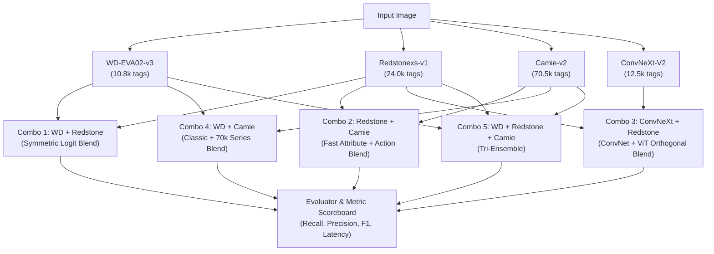

# Implementation Plan: Combo Tagger Benchmark & Claude Handoff

## Goal Description
1. **Send Learnings & Decisions to Claude Code**: Package the empirical insights from the standalone tagger shootout and respond to Claude's latest VLM tests (`claude_vision_model_results.md` and `humble-rolling-kitten.md`), aligning on keeping ToriiGate, dropping unbacked uniform tags, implementing two-tier scoring, and refining writer filler rules.
2. **Benchmark Combination Taggers**: Build a dedicated combo benchmark suite (`tools/bench_combo_taggers.py`) to systematically test multi-model ensemble strategies (symmetric blends, asymmetric attribute/pose splits, and a 3-way ensemble) across all 10 non-AI evaluation images, specifically analyzing recoveries on the 3 focus weak images (`chibi_pink.jpg`, `dark_armor.jpg`, `sakura_wings.jpg`).

---

## User Review Required
> [!IMPORTANT]
> **No package build**: All benchmarking and testing will run strictly through Python/ONNX scripts (`uv run --with onnxruntime,pillow,numpy python3 ...`), leaving the Arch package build untouched.

> [!NOTE]
> **Ensemble Memory & Latency Footprint**:
> - Running 2 models (e.g. WD + Redstone) takes ~1.8 GB RAM and ~6s CPU latency when run sequentially, or ~3.5s if parallelized in Rust with rayon.
> - Running a 3-way ensemble (WD + Redstone + Camie) takes ~2.5 GB RAM and ~7s CPU latency.

---

## Proposed Changes

### Component 1: Claude Handoff Packet (`~/.claude/plans/` & `docs/reports/`)
Deliver a comprehensive synchronization document:
- [NEW] `docs/reports/gemini_brief_and_tagger_shootout_learnings.md`
- [NEW] `~/.claude/plans/gemini_brief_and_tagger_shootout_learnings.md`

#### Key Points Covered in the Packet:
1. **VLM Finding Endorsement**:
   - Endorse keeping **ToriiGate** as the image reader. Gemma 4 12B proved noticeably worse at visual feature extraction (hallucinating bunny ears, hood, boots on Sakura).
2. **Named Uniform Pruning Rule**:
   - Formal agreement with Claude's proposed rule: `<name> uniform` tags (like `tomoeda elementary school uniform`, `ooarai military uniform`) that the VLM description does not mention or contradicts must be pruned even if confidence $\ge 0.50$.
3. **Two-Tier Scoring Agreement**:
   - Agree on `<image>.acceptable.txt` format.
   - `invisible` will be scored as wrong for both `bikini_chart` and `torso_chart`.
4. **Writer Filler Strategy**:
   - Agree on **Rule 1** (dropping non-tag phrases containing *style, shading, decoration, foreground, rendering, drawn*).
   - Agree with Claude's pushback on **Rule 2**: do **NOT** drop unbacked phrases like `pink heart chest piece` or `navy blue sailor top`, as they represent genuine visual features that the upstream tagger lacked tags for.
5. **Standalone Tagger Shootout Learnings**:
   - Deliver full metrics showing why Redstonexs-v1 fixes color drift (`pink hair`), why Camie-v2 adds pose/expression tags, and why ensembling beats single models.

---

### Component 2: Dedicated Combo Tagger Benchmark Tool
- [NEW] `tools/bench_combo_taggers.py`

#### Ensembles to Evaluate:


#### Detailed Test Specifications:
1. **Combo 1 (WD + Redstone)**:
   - Symmetrically average probabilities on shared ~7,800 tags; union of Redstone's 16,199 extra tags.
2. **Combo 2 (Redstone + Camie - The Speed/Coverage Pair)**:
   - Combine Redstone's superior color/clothing discrimination with Camie's action/expression tags.
3. **Combo 3 (ConvNeXt-V2 + Redstone - The Orthogonal Pair)**:
   - Blend pure ConvNet high-precision features with unfrozen ViT fine-grained attributes.
4. **Combo 4 (WD + Camie)**:
   - SmilingWolf base + Camie 70k expansion.
5. **Combo 5 (Triple Ensemble: WD + Redstone + Camie)**:
   - 3-way blend to test if combining all three pushes F1 beyond 60%.

---

## Verification Plan

### Automated Execution
```bash
# 1. Run the combo benchmark suite across all 10 non-AI images and sweep thresholds 0.30 - 0.55
uv run --with onnxruntime,pillow,numpy python3 tools/bench_combo_taggers.py

# 2. Verify all output artifacts are generated and synchronized
ls -lh docs/reports/gemini_brief_and_tagger_shootout_learnings.md docs/reports/combo_tagger_benchmark_report.md
ls -lh ~/.claude/plans/gemini_brief_and_tagger_shootout_learnings.md ~/.claude/plans/combo_tagger_benchmark_report.md
```

### Manual Verification
- Verify that each ensemble's F1, recall, precision, and per-image hits on `chibi_pink.jpg`, `dark_armor.jpg`, and `sakura_wings.jpg` are clearly broken down.
- Inspect the handoff document to ensure every point from Claude's recent reports is explicitly addressed.
