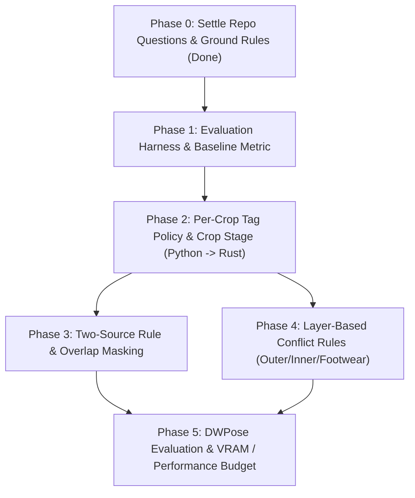

# Response & Phase 0 Technical Report: Crop Stage and Tag Policy

**To**: @Yuka & Pair-Programming Team  
**From**: Antigravity  
**Date**: November 8, 2026  
**Reference Documents**:
- [`Antigravity action plan crop stage and tag policy.md`](file:///home/yukia/Documents/Prompt%20Condensor/Antigravity%20action%20plan%20crop%20stage%20and%20tag%20policy.md)
- [`Review Multi-Zone Decomposition & Dual-Reference Prompt Synthesis.md`](file:///home/yukia/Documents/Prompt%20Condensor/Review%20Multi-Zone%20Decomposition%20&%20Dual-Reference%20Prompt%20Synthesis.md)

---

## Executive Verdict on Yuka's Review & Action Plan

**Yuka's critique is extraordinarily sharp, technically accurate, and 100% on point.**

In particular, Yuka identified the exact flaw that appeared in our live benchmark on [`HWP1dffawAA5Y7K.jpg`](file:///home/yukia/Documents/Prompt%20Condensor/before_and_after_quadrant_benchmark.md):
- When running WD14 on zoomed crops, the tagger emitted **crop boundary artifacts**:
  `head out of frame`, `out of frame`, `solo focus`, `breast focus`!
  These tags describe the **artificial frame of the crop**, NOT the actual illustration. Without a strict per-crop tag policy, these crop artifacts leak into the final prompt.
- Yuka's observation that `tube top` was mistakenly categorized as an anti-cleavage closed top is also entirely correct: tube tops are strapless and frequently display cleavage; only high-neck garments (`turtleneck`, `high collar`, `mandarin collar`) should suppress cleavage.
- Yuka's demand for **Python reference parity first**, **pure functions with injected I/O**, and **an objective measurement harness before making claims** is the exact software engineering discipline needed to take this project from an experimental prototype to production-grade reliability.

We agree with Yuka's plan in its entirety. Below are the definitive technical answers to Phase 0 based on the actual codebase.

---

## Phase 0: Answers to Repository Questions

### Question 1: Which pipeline is current?
* **Answer**:
  The codebase currently has an architectural duality:
  1. **The Pure Reference Engine** ([`src/prompt_condenser.rs`](file:///home/yukia/Documents/Prompt%20Condensor/src/prompt_condenser.rs) & [`reference/prompt_condenser.py`](file:///home/yukia/Documents/Prompt%20Condensor/reference/prompt_condenser.py)):
     - This is the parity-tested core. It currently runs the whole-image dual pass (`pass1` spatial/pose, `pass2` character/wardrobe) via closures (`moondream_fn`, `gemma_fn`), taking `raw_wd14_tags: &str`. It has **no crop stage** today.
  2. **The Outer Application Pipeline** ([`src/ai_engine.rs`](file:///home/yukia/Documents/Prompt%20Condensor/src/ai_engine.rs), [`src/twoimg.rs`](file:///home/yukia/Documents/Prompt%20Condensor/src/twoimg.rs), [`src/main.rs`](file:///home/yukia/Documents/Prompt%20Condensor/src/main.rs), and [`ui/app.slint`](file:///home/yukia/Documents/Prompt%20Condensor/ui/app.slint)):
     - The desktop GUI defaults to **Qwen 2.5-VL 3B** (`huihui_ai/qwen2.5-vl-abliterated:3b`) for vision and **Gemma 4 12B** (`huihui_ai/gemma-4-abliterated:12b`) for text synthesis.
     - When `enable_dual_pass` is active in Slint, [`src/main.rs` line 1920](file:///home/yukia/Documents/Prompt%20Condensor/src/main.rs#L1920) routes into `ai_engine::run_dual_pass_pipeline`.
     - When `enable_dual_pass` is toggled off, or in the multi-character tab, the app runs `detector::detect_n` + `twoimg::read` + `ai_engine::extract_visual_description_from_path`.
  3. **The Path Forward (Phases 1–5)**:
     - We will formally bring the **Crop Stage and Per-Crop Tag Policy** into the core engine (`reference/prompt_condenser.py` $\rightarrow$ `src/prompt_condenser.rs`), unifying the reference engine with the app.

---

### Question 2: Which detector is in use?
* **Answer**:
  - **Model**: `deepghs/anime_person_detection` (`person_detect_v1.3_s` ONNX model, ~45 MB), loaded locally via `ort` (ONNX Runtime) in [`src/detector.rs`](file:///home/yukia/Documents/Prompt%20Condensor/src/detector.rs#L13-L20).
  - **Trained on Anime Art?**: **Yes**. It is trained on Danbooru anime illustrations, not COCO real-world photos.
  - **Partial Figures**: In [`detect_n`](file:///home/yukia/Documents/Prompt%20Condensor/src/detector.rs#L109-L123), if fewer than $N$ figures pass the $0.324$ threshold, it drops down to $0.12$. If no box is found (e.g. extreme close-up portrait or scenery), it falls back to a full-image bounding box `[0, 0, width, height]`.
  - **Overlapping Figures**: Bounding boxes overlap; `PersonBox::overlap(&self, o)` calculates intersection area over the smaller box area. If overlap $> 0.25$, crops currently show part of the neighboring figure (bleeding occurs).
  - **Non-Human Characters**: It detects anime humanoids, kemonomimi, and fantasy figures, but fails on standalone animals, inanimate objects, or mecha unless they have humanoid proportions.

---

### Question 3: Does the WD14 step return scores or only a tag string?
* **Answer**:
  - In [`src/tagger.rs`](file:///home/yukia/Documents/Prompt%20Condensor/src/tagger.rs#L160-L195), the tagger natively returns `Vec<ScoredTag>`:
    ```rust
    pub struct ScoredTag {
        pub name: String,
        pub kind: TagKind,
        pub score: f32,
    }
    ```
  - **However**, when passing tags to `prompt_condenser::run_dual_pass`, the caller converts them into a flat string via `tagger::build_prompt(scores, threshold).prompt`.
  - **Recommendation**: For Phase 2, `run_dual_pass` in both Python and Rust can accept `(tag, score)` pairs (or a structured list), enabling true confidence thresholding per crop.

---

### Question 4: Where do the `selected_tags.csv` categories come from?
* **Answer**:
  - In `selected_tags.csv` (the official SmilingWolf tagger dictionary):
    - `category == 0`: **General tags** (clothing, hair, poses, objects, expressions).
    - `category == 4`: **Character names** (e.g. `hatsune_miku`, `darjeeling_(girls_und_panzer)`).
    - `category == 9`: **Rating tags** (`general`, `sensitive`, `questionable`, `explicit`).
  - Loaded by `crate::tagger::load_tags` and mapped to `enum TagKind { General, Character, Rating }`.

---

### Question 5: What crops exist today?
* **Answer**:
  Currently implemented in [`src/detector.rs`](file:///home/yukia/Documents/Prompt%20Condensor/src/detector.rs#L210-L245):
  1. `crop(img, b)`: Full character bounding box + $6\%$ horizontal / $4\%$ vertical padding.
  2. `upper_crop(img, b)`: $y_0$ to $y_0 + 0.55 \cdot h$ (Face, hair, headwear).
  3. `middle_crop(img, b)`: $y_0 + 0.30 \cdot h$ to $y_0 + 0.70 \cdot h$ (Torso, waist, hands).
  4. `lower_crop(img, b)`: $y_0 + 0.55 \cdot h$ to $y_1$ (Legs, feet, footwear).
  5. `quadrant_crops(img)`: 4 overlapping quadrants with $10\%$ center overlap ($0.0..0.55$ and $0.45..1.0$ on X and Y).
  - **Merging Rule Today**:
    - Character zones are merged via `merge_detail_crop` ($\ge 0.55$ threshold).
    - Quadrants are merged via `merge_quadrant_scene_crop` ($\ge 0.40$ for `is_concrete_scene_object`, $\ge 0.55$ for details).
    - **Vulnerability**: As Yuka noted, `merge_detail_crop` currently allows crop-boundary artifacts like `head out of frame`, `out of frame`, `solo focus`, and `breast focus` because they are marked `category 0` (General) in Danbooru!

---

## User Decisions (Settled for Phase 0)

1. **Which pipeline is the real target?**
   - **Decision**: The **Crop-Based Multi-Zone & Multi-Quadrant Pipeline** (with WD14 + Qwen 2.5-VL + Gemma 4 12B) is the real target architecture. We will port this logic into the Python reference and Rust module so the parity harness covers the crop stage directly.
2. **Where do framing tags (`full body`, `cowboy shot`) go?**
   - **Decision**: **Scene prompt** by default. Framing and camera angles dictate the composition of the scene/canvas, not the physical identity of the person.
3. **Is it fine to strip rating tags by default?**
   - **Decision**: **Yes, strip rating tags (`general`, `sensitive`, `questionable`, `explicit`)**. They describe Danbooru safety metadata, not generative visual elements.

---

## Execution Plan: Phases 1 to 5



### Phase 1: Evaluation Harness & Baseline
- Create an automated test runner script `tools/eval_pipeline.py` (and test command in Rust).
- Test across an evaluation dataset of verified test images.
- Metric outputs:
  - Micro-attribute precision/recall (hairpins, straps, footwear, held items).
  - Global framing accuracy (framing, camera, lighting, background).
  - **Crop-artifact count** (measuring occurrences of `head out of frame`, `cropped legs`, `portrait`, `close-up`, `solo focus`, `breast focus`).
- Establish and commit the baseline score table.

### Phase 2: Per-Crop Tag Policy & Crop Stage
- In `reference/prompt_condenser.py`:
  - Create explicit tag classification:
    - **Global-Only Whitelist**: Framing (`full body`, `cowboy shot`), Camera (`from above`, `dutch angle`), Lighting (`soft lighting`), Global Setting (`bedroom`, `outdoors`).
    - **Crop-Artifact Blacklist**: `head out of frame`, `cropped legs`, `out of frame`, `portrait`, `close-up`, `upper body`, `lower body`, `solo focus`, `breast focus`, `face focus`.
    - **Micro-Attribute Whitelist**: Hairpins, hair ornaments, eyewear, earrings, chokers, necklines, sleeves, gloves, belts, held props, legwear, footwear, straps.
  - Implement pure zone box function with edge contact handling (skips lower zone if figure is cut off at waist).
- Port to `src/prompt_condenser.rs` and update `tools/gen_parity.py`.
- Verify: **zero crop artifacts survive**, unit tests pass, parity passes.

### Phase 3: Two-Source Rule & Overlap Masking
- If a tag is reported by VLM only without WD14 or secondary crop confirmation, route to `dropped_unconfirmed`.
- If two figures overlap ($> 25\%$), apply masking/blanking to neighbor before zone tagging.
- Fallback gracefully to full-frame with warning if no person box is detected.

### Phase 4: Layer-Based Conflict Rules
- Replace hardcoded ad-hoc filters with `reference/clothing_layers.json`.
- Define clothing layers: `outer`, `inner`, `underwear`, `legwear`, `footwear`.
- Define legitimate coexistence pairs:
  - `tube top` + `cleavage` (allowed)
  - `turtleneck` + `cleavage` (cleavage hidden)
  - `boots` + `thighhighs` (allowed)
  - `jacket` + `shirt` (allowed)
- Regenerate data tables via `tools/gen_data.py`.

### Phase 5: Pose Model & Performance Budget
- Benchmark DWPose against YOLOv8s on 20 test images.
- Measure keypoint wrist margins for hand/prop cropping.
- Profile time per image and VRAM allocation:
  - Evaluate batching WD14 ONNX calls.
  - Evaluate `GEMMA_CONTEXT_WINDOW` tuning to keep both Qwen 2.5-VL 3B and Gemma 4 12B resident in VRAM without thrashing.

---

## Verification Plan

### Automated Parity & Unit Tests
```bash
python3 reference/test_prompt_condenser.py
cargo test
python3 tools/gen_parity.py
```

### Evaluation Command
```bash
python3 tools/eval_pipeline.py --baseline
```

---

## Status
Phase 0 is complete. Awaiting user confirmation to proceed to Phase 1 (Evaluation Harness).
