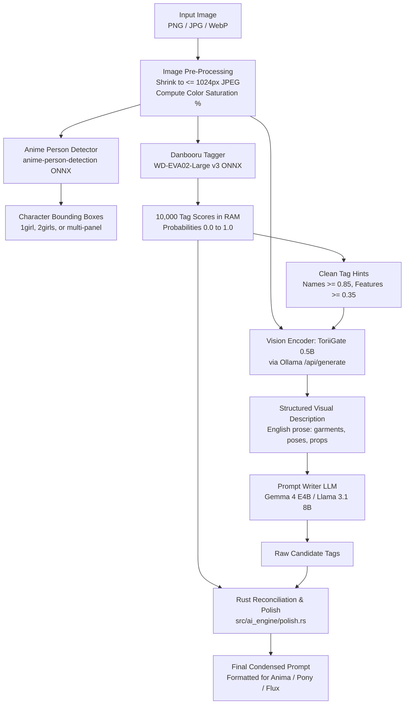

# Deep Dive: How the Vision Pipeline Works in Prompt Condenser

This guide explains the end-to-end architecture of how Prompt Condenser "sees" an image, understands what is in it, and generates a faithful, high-precision prompt.

---

## 1. High-Level Architecture Overview

Prompt Condenser uses a **hybrid multi-model pipeline**: it combines a specialized neural tag classifier, a lightweight vision-language model (VLM), a writer LLM, and a deterministic Rust reconciliation engine.



---

## 2. Step-by-Step Breakdown

### Step 1: Pre-Processing & Chromatic Analysis
* **Shrinking** ([`shrink_for_vision`](file:///home/yukia/Documents/Prompt%20Condensor/src/ai_engine/vision.rs#L64)):
  Vision models gain nothing from giant 4K resolutions and run much slower. Images larger than 1024px on their longest side are resized using triangle filtering and converted to 85% quality JPEG in memory.
* **Color Check** ([`strongly_colored_pixel_share`](file:///home/yukia/Documents/Prompt%20Condensor/src/ai_engine/vision.rs)):
  The image's HSV saturation is measured on a 400px thumbnail. If strongly colored pixels exceed **$1.5\%$**, the image is confirmed to be full-color. Any erroneous `monochrome` guesses from the tagger (caused by small sketch insets or dark borders) are discarded immediately.

---

### Step 2: The Fast ONNX Neural Scanners (~2 seconds)
Before calling any heavy AI text models, Prompt Condenser runs two fast, local C++ / ONNX Runtime models:
1. **Anime Person Detection** ([`src/detector.rs`](file:///home/yukia/Documents/Prompt%20Condensor/src/detector.rs)):
   Uses `anime-person-detection-v1.3s.onnx` to locate people and calculate their bounding boxes. This tells the system if the picture is `1girl`, `2girls`, or a multi-panel comparison.
2. **WD-EVA02-Large-v3 Tagger** ([`src/tagger.rs`](file:///home/yukia/Documents/Prompt%20Condensor/src/tagger.rs)):
   SmilingWolf's EVA02 Vision Transformer processes the image at 448×448 resolution in **~1.5 seconds**. It computes probabilities for all 10,000+ Danbooru tags and stores them in RAM.

---

### Step 3: The Vision Model Pass (ToriiGate 0.5B via Ollama, ~12 seconds)
[`src/ai_engine/vision.rs::observe_with_toriigate`](file:///home/yukia/Documents/Prompt%20Condensor/src/ai_engine/vision.rs#L841)

Prompt Condenser's default vision model is **ToriiGate 0.5B** (Minthy's specialized anime captioning vision model running in GGUF format through Ollama).
* **Why not a generic vision model?** Generic vision models (like LLaVA or GPT-4o-mini) often fail at anime hair geometry, stylized clothing, and Japanese accessories.
* **Prompting ToriiGate**:
  ToriiGate is sent the image alongside the high-confidence tagger hints. It is instructed using its native `min_structured_md` format:
  ```markdown
  # 1. Thoughts about characters
  (Identifies recognized characters like 'Nishizumi Miho' or writes 'No named characters')
  # 2. Key details
  (Plain English description of clothing layers, held items, footwear, gestures)
  # 3. Structured description
  (General scene composition, lighting, camera angles, perspective foreshortening)
  ```
* **Output**: A faithful, 3-to-5 sentence descriptive English breakdown of what is actually visible.

---

### Step 4: The Prompt Writer LLM (Gemma 4 E4B / 12B, ~10 seconds)
[`src/ai_engine/vision.rs::describe_image_with_desc`](file:///home/yukia/Documents/Prompt%20Condensor/src/ai_engine/vision.rs)

The writer language model takes ToriiGate's English prose description and translates it into the target format:
* **For Pony / Anima (Danbooru Checkpoints)**: Converts natural descriptions into standard comma-separated Danbooru tags, ordered by importance: Character $\to$ Hair/Face $\to$ Outfits $\to$ Pose $\to$ Setting.
* **For Flux / SD3**: Formats into rich natural language sentences with quality triggers.

---

### Step 5: The Rust Reconciliation & Polish Engine (<10 milliseconds)
[`src/ai_engine/polish.rs::polish_image_prompt_with`](file:///home/yukia/Documents/Prompt%20Condensor/src/ai_engine/polish.rs#L314)

LLMs are creative, but they sometimes drop subtle tags or hallucinate non-Danbooru phrases. Rust acts as the strict editor:

1. **Character Hallucination Gate**:
   A character name (e.g., `suzukaze aoba`) is only kept if the tagger independently recognized the character ($\ge 0.85$). If the LLM guessed a random name, it is removed.
2. **Danbooru Dictionary Validation**:
   Every tag is validated against Danbooru's ~10,000 tag dictionary (`crate::danbooru::local()`).
3. **Tagger Reconciliation (`restore_tagger_tags`)**:
   If the writer dropped tags that the tagger was confident in ($\ge 0.50$, such as `underboob`, `navel`, `large breasts`, or specific footwear), Rust restores them to the prompt.
4. **Contradiction Guards**:
   - Drops `barefoot` if shoes or sneakers are present.
   - Enforces a single hair color for solo characters (avoiding pink + orange + blonde duplicates).
   - Exempts multi-character images (`2girls`) so both characters retain their own eye and hair colors.
5. **Checkpoint Prefixing**:
   Automatically prepends the correct quality tokens (`masterpiece, best quality` or `score_9, score_8_up`).

---

## 3. Summary of Models Used

| Component | Engine / Runtime | Model | Role | Time |
| :--- | :--- | :--- | :--- | :---: |
| **Detector** | ONNX Runtime (CPU) | `anime-person-detection-v1.3s` | Counts characters and finds bounding boxes | ~0.5 s |
| **Tagger** | ONNX Runtime (CPU/GPU) | `wd-eva02-large-tagger-v3` | 10,000 Danbooru tag probabilities | ~1.5 s |
| **Vision (VLM)** | Ollama (Vulkan/GPU) | `ToriiGate-0.5-GGUF` | Reads raw pixels and writes English description | ~12 s |
| **Writer (LLM)** | Ollama (Vulkan/GPU) | `prompt-condenser-gemma4-e4b` | Formats description into checkpoint-ready prompt | ~10 s |
| **Polish Engine** | Native Rust | Custom deterministic rules | Deduplication, validation, reconciliation | <0.01 s |
| **Total** | | | **Full end-to-end scan** | **~25–30 s** |
