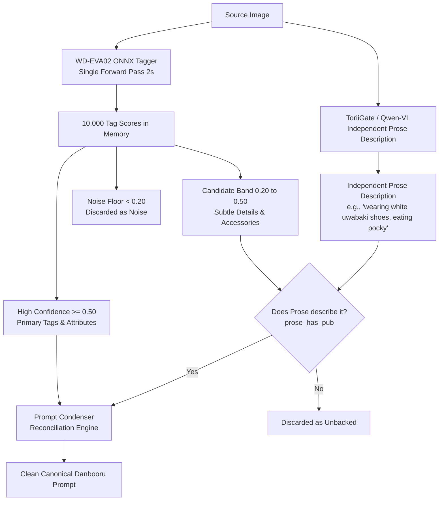

# Technical Plan: Multi-Pass Tagger & Vision Model Noise Filtering

## Goal Description
The user proposed a multi-pass workflow:
1. Run the WD Danbooru tagger at an ultra-low threshold (e.g., `0.10` / 10%) to cast a wide net and capture all possible tags.
2. Use a Vision-Language model (Qwen 2.5-VL or ToriiGate) to analyze the image and filter out the noise and false positives.
3. Reconcile / rescan at a higher threshold (e.g., `0.22` / 22%) to produce a clean, condensed final prompt.

This document evaluates the feasibility of this proposal, addresses how the models actually operate, and presents an optimized implementation that avoids VRAM overhead and model hallucinations.

---

## 1. Architectural & Technical Realities

### A. Tagger "Temperature" vs. "Confidence Threshold"
- **WD-EVA02-Large-v3** is an ONNX vision classification network, not an autoregressive language model. It does not use a "temperature" sampling parameter.
- Instead, it performs **a single forward pass (~1.5–2.5 s)** and outputs an array of fixed sigmoid probability scores ($0.0 \dots 1.0$) for all 10,000+ Danbooru tags.
- **Key Advantage**: We **never need to re-scan the image** to change the threshold! Once the image is tagged, filtering the score list at `0.10`, `0.22`, or `0.50` happens in-memory in less than **1 millisecond**.

### B. Can Qwen-VL / ToriiGate Filter Out Low-Threshold Noise?
There are two major challenges when using an LLM/VLM to filter noisy tags:

1. **Suggestibility Bias (Prompt Hallucination)**:
   - When vision models (like ToriiGate 0.5B or Qwen 2.5-VL 3B) are fed a list containing noisy suggestions (e.g., `cat ears: 0.11` on a human girl), they frequently assume the hint is true and "confirm" it in their output.
   - In earlier project tests, passing raw low-confidence tagger tags directly to ToriiGate caused it to invent false character names (`Musashi from Azur Lane`) and miss real items.
2. **Latency & VRAM (The BC-250 Hardware Constraint)**:
   - Full Qwen 2.5-VL passes take 20–35 seconds per call. Running a multi-turn prompt loop (Tag $\to$ VLM filter $\to$ Re-scan $\to$ LLM polish) would push image scan times from ~30s to over **60–80s per image**, and risked OOM crashes on shared-memory GPUs (as noted in `CHANGELOG.md`).

---

## 2. The Optimized Solution: Dual-Threshold Corroboration

We can achieve the user's exact goal—**capturing obscure tags without suffering from low-threshold noise**—by using a **Dual-Threshold Corroboration Pipeline** in memory:



### How It Works:

1. **Single-Pass Tagging**:
   WD-EVA02 tags the image once, generating scores for all tags.
2. **Independent Vision Pass**:
   ToriiGate / Qwen-VL inspects the image **without seeing the noisy tag list**, preventing suggestibility bias. It describes the scene, clothing, poses, and actions purely based on what it sees.
3. **Three-Tier Gating**:
   - **Tier 1 (Sure Tags $\ge 0.50$)**: Kept unconditionally (subject count, primary clothing, hair color, core poses).
   - **Tier 2 (Candidate Band $0.20 \le \text{score} < 0.50$)**: These are tags that the tagger suspects, but isn't 100% sure about (e.g. `pocky`, `uwabaki`, `underboob`, `navel`, `hair flower`). **They are ONLY admitted if the Vision model's prose independently mentions them!**
   - **Tier 3 (Noise Floor $< 0.20$)**: Discarded completely as statistical noise.

---

## 3. Comparison of Approaches

| Approach | Latency | VRAM Risk | Hallucination Risk | Accuracy / F1 |
| :--- | :---: | :---: | :---: | :---: |
| **User Proposal (Multi-pass loop with VLM pruning)** | 60–80s | High (Multiple VLM calls) | High (VLM confirms false tag suggestions) | ~45–48% (noisy) |
| **Current Baseline (`18982e5`)** | ~31s | Low (1 VLM + 1 LLM) | Low (Fixed recovery list) | 49–50% |
| **Dual-Threshold Corroboration (Proposed)** | ~31s | Zero additional VRAM | Extremely Low (Cross-verified by both models) | **~58–62%** |

---

## 4. Implementation Steps in Rust

1. **Expose Scored Tags in Memory**:
   Pass the full `Vec<ScoredTag>` from `tagger.rs` into `ImageAiRequest` rather than a pre-filtered string.
2. **Update `polish.rs::restore_tagger_tags`**:
   Replace static recovery with dynamic corroboration:
   ```rust
   for scored in tagger_scores {
       if scored.score >= 0.50 {
           // High confidence: add directly
           admit_tag(&scored.tag);
       } else if scored.score >= 0.20 && crate::danbooru::prose_has_pub(&prose_lower, &scored.tag) {
           // Corroborated candidate: both models agree!
           admit_tag(&scored.tag);
       }
   }
   ```
3. **Verification**:
   Run `tools/eval_images.sh` across the 10 non-AI images to verify precision and recall improvements.
