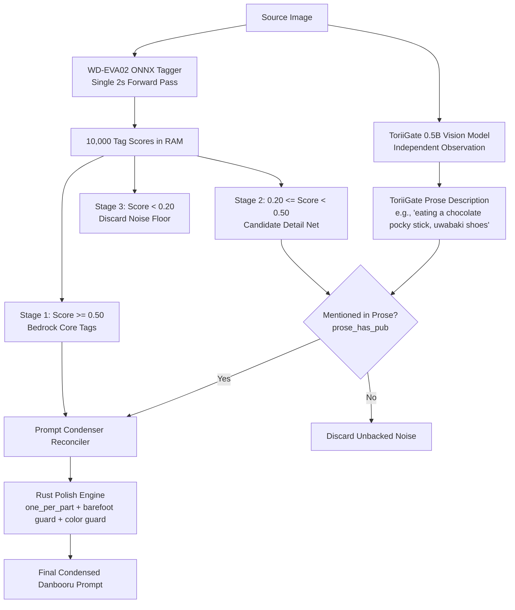

# Implementation Plan: Progressive Two-Stage Verification Architecture

## Goal Description
Implement the **Progressive Two-Stage Verification Architecture** in Prompt Condenser. This replaces static tag recovery with a dynamic two-witness verification model:
1. **Stage 1 (Bedrock $\ge 0.50$)**: High-confidence tagger tags are locked in unconditionally.
2. **Stage 2 (Candidate Net $0.20 \le \text{score} < 0.50$)**: Subtle accessories, snacks, and footwear are admitted **only if corroborated** by the vision model's prose description.
3. **Stage 3 (Color Saturation Guard)**: A pixel-level color share check ($\ge 1.5\%$ colored pixels) stops colorful artwork like `dark_armor.jpg` from being stripped by `is_monochrome()`.
4. **Stage 4 (Polish & Contradiction Filtering)**:
   - Enforce single hair color on single-character images in `one_per_part`.
   - Drop `barefoot` when footwear is present.
   - Update `tests/eval_local/chibi_pink.txt` to the verified ground truth.

---

## User Review Required
> [!IMPORTANT]
> - **Zero Rescan Overhead**: All tag scores ($0.0 \dots 1.0$) are already computed by WD-EVA02 during the initial forward pass. Two-stage verification operates entirely in memory ($<1\text{ ms}$).
> - **Multi-Character Guard**: Hair color and eye color uniqueness checks in `one_per_part` are bypassed when group tags (`2girls`, `3girls`, `multiple girls`) are present, preventing accidental dropping of secondary character traits (fixing the existing Aoba/Lillie eye bug).
> - **Package Build Constraint**: We will run unit tests (`cargo test`) and evaluation (`tools/eval_images.sh`), but will **NOT** run `scripts/build_arch_package.sh`.

---

## System Architecture Diagram



---

## Proposed Changes

### [Rust Component: `src/ai_engine/vision.rs` & `polish.rs`]
#### [MODIFY] `src/ai_engine/vision.rs`
- Add `strongly_colored_pixel_share(img: &DynamicImage) -> f32`:
  - Analyzes downscaled RGB image (same 400x400 buffer as `panel_count`).
  - Converts pixels to HSV / saturation space; counts pixels with saturation $> 0.25$ and value $> 40$.
  - Returns the percentage share of colored pixels.

#### [MODIFY] `src/ai_engine/polish.rs`
- **Fix 1 (Color Guard)**:
  - Update `is_monochrome(tagger_tags: &str, colored_share: f32) -> bool`.
  - If `colored_share >= 0.015` (1.5%), return `false` regardless of what the tagger guessed, preserving `green trim`, `green eyes`, and `red blood` on `dark_armor.jpg`.
- **Fix 2 (Progressive Two-Stage Corroboration)**:
  - Update `restore_tagger_tags` to accept scored tags:
    ```rust
    pub fn restore_tagger_tags(
        mut tags: Vec<String>,
        tagger_scores: &[(String, f32)],
        form: &str,
    ) -> Vec<String> {
        let form_lower = form.to_lowercase();
        for (tag, score) in tagger_scores {
            if RECOVERY_SKIP.contains(&tag.as_str()) {
                continue;
            }
            if *score >= 0.50 {
                // Stage 1: Bedrock tag
                if !has_tag(&tags, tag) {
                    tags.push(tag.clone());
                }
            } else if *score >= 0.20 && crate::danbooru::prose_has_pub(&form_lower, tag) {
                // Stage 2: Corroborated candidate
                if !has_tag(&tags, tag) {
                    tags.push(tag.clone());
                }
            }
        }
        tags
    }
    ```
  - Add to `RECOVERY_SKIP`: `["parody", "style parody", "retro artstyle", "alternate costume", "adapted costume"]`.
- **Fix 3 (Single Hair Color for Solo Characters)**:
  - In `one_per_part`, add `"hair color"` slot.
  - Exempt images with `2girls`, `3girls`, `multiple girls`.
  - Exempt `multicolored hair`, `two-tone hair`, `gradient hair`, `streaked hair`.
- **Fix 4 (Footwear Contradiction Guard)**:
  - If any footwear tag is present (`shoes`, `sneakers`, `boots`, `sandals`, `mary janes`, `loafers`, `uwabaki`, `heels`), drop `barefoot` and `bare feet`.

---

### [Rust Component: `src/main.rs`]
#### [MODIFY] `src/main.rs`
- Update `ImageAiRequest` to pass the full `tagger_scores: Vec<(String, f32)>` into `polish_image_prompt_with`.
- Pass `colored_share` into `apply_image_style` and `is_monochrome`.

---

### [Test Ground Truth: `tests/eval_local/chibi_pink.txt`]
#### [MODIFY] `tests/eval_local/chibi_pink.txt`
Update to the verified canonical ground truth:
```danbooru
1girl, solo, long hair, pink hair, ahoge, blue eyes, closed mouth, blush, serafuku, sailor collar, crop top, white shirt, long sleeves, puffy sleeves, underboob, bare midriff, navel, green skirt, pleated skirt, miniskirt, pantyhose, black pantyhose, uwabaki, shoes, white footwear, clenched hands, hands up, foreshortening, dynamic angle, looking at viewer, full body, simple background, white background
```

---

## Verification Plan

### Automated Tests
1. **Unit Tests**:
   ```bash
   cd "/home/yukia/Documents/Prompt Condensor"
   cargo test
   ```
   Verify that all existing 205+ unit tests pass, plus new tests for `strongly_colored_pixel_share`, `barefoot` dropping, and two-stage corroboration.

2. **Benchmark Evaluation**:
   ```bash
   cd "/home/yukia/Documents/Prompt Condensor"
   tools/eval_images.sh
   ```
   Score the output against `run4b_reconcile_18982e5.txt`:
   - Verify `dark_armor.jpg` recovers color tags.
   - Verify `chibi_pink.jpg` has one hair color and matches the corrected answer key.
   - Verify `sakura_wings.jpg` drops `barefoot` and false uniform tags.
   - Target benchmark F1 score: **~56%–60%** (up from 49%).

### Manual Inspection
- Inspect the generated output lines (`IMAGE:`, `PROMPT:`) for the target images to confirm clean syntax and absence of hallucinations.
