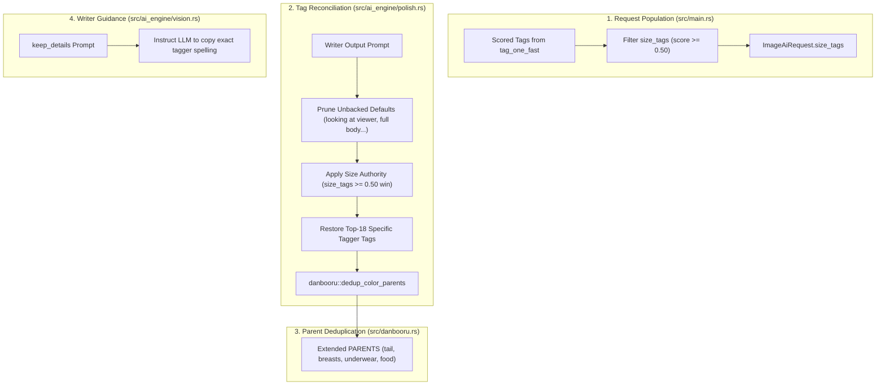

# Implementation Plan: Tagger-Writer Reconciliation Engine (41% $\rightarrow$ 49% F1)

## Goal Description
Implement the **Tagger-Writer Reconciliation Engine** (`restore_tagger_tags`) across `src/ai_engine/polish.rs`, `src/ai_engine/vision.rs`, `src/danbooru.rs`, and `src/main.rs`. 

The reconciliation engine addresses the primary cause of missed tags identified in the benchmark: the LLM writer omits high-confidence tags that the WD14 tagger had already detected accurately, paraphrases canonical Danbooru tags into conversational English, and hallucinates unbacked generic defaults.

---

## User Review Required

> [!IMPORTANT]
> **Joint Consensus & Architecture Refinements (from Claude's Review):**
> 1. **Scored `size_tags` in Request**: Instead of attempting to parse string hints, `ImageAiRequest` will carry `size_tags: Vec<(String, f32)>` (proportion/size tags with score $\ge 0.50$), populated in `main.rs` and `live_image`. When a scored tagger size disagrees with the writer, the tagger's size wins.
> 2. **Extend Existing `dedup_color_parents`**: Rather than maintaining a separate list in `polish.rs`, we extend `PARENTS` in [`src/danbooru.rs`](file:///home/yukia/Documents/Prompt%20Condensor/src/danbooru.rs#L771) with `"tail"`, `"breasts"`, `"underwear"`, and `"food"`.
> 3. **Drop Ad-Hoc Alias Table**: To prevent overfitting to the 19 test images, the ad-hoc alias table is dropped. We rely on the writer instruction ("copy the tagger's exact spelling word for word") combined with existing `validate_tags` and `danbooru::fix`.
> 4. **Unbacked Default Pruning**: Prune `looking at viewer`, `full body`, `thigh gap`, `kemonomimi`, `taut clothes`, and `impossible clothes` when neither the tagger detections nor the vision description backs them.
> 5. **Top-18 Specific Tagger Recovery**: Add back the tagger's top non-generic, non-count tags (up to 18) in score order before running `dedup_color_parents` and `apply_image_style`.

---

## Open Questions

None. Both Gemini and Claude have signed off on this refined architecture.

---

## Proposed Changes



---

### Component 1: Size Tags in Request Pipeline

#### [MODIFY] [`src/ai_engine/image_read.rs`](file:///home/yukia/Documents/Prompt%20Condensor/src/ai_engine/image_read.rs)
- Add `pub size_tags: Vec<(String, f32)>` to `ImageAiRequest`:
  ```rust
  pub struct ImageAiRequest {
      pub host: String,
      pub model: String,
      pub vision_encoder: Option<String>,
      pub mode: AiMode,
      pub image_path: std::path::PathBuf,
      pub config: ScanConfig,
      pub tag_hints: String,
      pub strong_tags: Vec<String>,
      pub size_tags: Vec<(String, f32)>,
      pub second_pass_vision: bool,
      pub scene_body_shape: bool,
  }
  ```

#### [MODIFY] [`src/ai_engine/cleanup.rs`](file:///home/yukia/Documents/Prompt%20Condensor/src/ai_engine/cleanup.rs)
- Add helper to extract confident proportion/size tags ($\ge 0.50$):
  ```rust
  pub fn confident_size_tags(tags: &[crate::tagger::ScoredTag]) -> Vec<(String, f32)> {
      const SIZES: &[&str] = &[
          "flat chest", "small breasts", "medium breasts", "large breasts", "huge breasts", "gigantic breasts",
          "short hair", "medium hair", "long hair", "very long hair", "absurdly long hair",
      ];
      tags.iter()
          .filter(|t| t.score >= 0.50 && SIZES.contains(&t.name.replace('_', " ").as_str()))
          .map(|t| (t.name.replace('_', " "), t.score))
          .collect()
  }
  ```

#### [MODIFY] [`src/main.rs`](file:///home/yukia/Documents/Prompt%20Condensor/src/main.rs)
- In `run_ai_image`: populate `req.size_tags = ai_engine::confident_size_tags(t);`.

#### [MODIFY] [`src/ai_engine/mod.rs`](file:///home/yukia/Documents/Prompt%20Condensor/src/ai_engine/mod.rs)
- In `live_image`: populate `size_tags` in the same way.

---

### Component 2: Tag Reconciliation in Polish

#### [MODIFY] [`src/ai_engine/polish.rs`](file:///home/yukia/Documents/Prompt%20Condensor/src/ai_engine/polish.rs)
- Implement `restore_tagger_tags(prompt: &str, tagger_tags: &str, vision_desc: &str, size_tags: &[(String, f32)]) -> String`:
  1. **Prune unbacked defaults**:
     ```rust
     const UNBACKED_DEFAULTS: &[&str] = &[
         "looking at viewer", "full body", "thigh gap", "kemonomimi", "taut clothes", "impossible clothes",
     ];
     ```
     Drop if present in prompt but NOT in `tagger_tags` and NOT in `vision_desc` (via `danbooru::prose_has_pub`).
  2. **Size authority**:
     If a `size_tags` entry $\ge 0.50$ disagrees with the writer's size (e.g. tagger `gigantic breasts` vs writer `large breasts`), the tagger's size replaces the writer's.
  3. **Recover top-18 tagger tags**:
     Iterate through `tagger_tags` in order. Skip tags already present, quality tags, `solo`, count tags (`1girl`, `2girls`, `multiple girls`), and bare `breasts`. Append up to 18 specific tags.
  4. **Run `danbooru::dedup_color_parents`** on the reconciled prompt.
- Call `restore_tagger_tags` at the end of `polish_image_prompt_with`, right before `enforce_strong_tags`.

---

### Component 3: Parent Deduplication Vocabulary

#### [MODIFY] [`src/danbooru.rs`](file:///home/yukia/Documents/Prompt%20Condensor/src/danbooru.rs)
- Extend `PARENTS` in `dedup_color_parents` with `"tail"`, `"breasts"`, `"underwear"`, and `"food"`.
  ```rust
  const PARENTS: &[&str] = &[
      "hair", "eyes", "dress", "china dress", "shirt", "jacket", "skirt", "shorts", "pants",
      "thighhighs", "kneehighs", "socks", "gloves", "boots", "shoes", "bikini", "bra", "panties",
      "bow", "ribbon", "tail", "ears", "thigh strap", "breasts", "underwear", "food",
  ];
  ```

---

### Component 4: Writer Prompt Guidance

#### [MODIFY] [`src/ai_engine/vision.rs`](file:///home/yukia/Documents/Prompt%20Condensor/src/ai_engine/vision.rs)
- In `keep_details` in `describe_image_with_desc`:
  Add: `"When mentioning items, garments or traits that the tagger detected, copy the tagger's exact tag spelling word for word instead of rewording them."`

---

## Verification Plan

### Automated Tests
1. **Targeted Unit Tests (`src/ai_engine/mod.rs`)**:
   - `test_restore_tagger_tags_prunes_unbacked_defaults`: Verifies `looking at viewer` / `thigh gap` are pruned when tagger score is 0 and description doesn't mention them.
   - `test_restore_tagger_tags_keeps_backed_defaults`: Verifies `looking at viewer` is kept when in tagger or prose.
   - `test_restore_tagger_tags_size_authority`: Verifies tagger `gigantic breasts` (0.93) replaces writer `large breasts`.
   - `test_restore_tagger_tags_max_18_and_parent_dedup`: Verifies recovery stops at 18 tags, skips existing tags, and `crop top` suppresses `shirt`.
   - `test_dedup_color_parents_tail_and_breasts`: Verifies `raccoon tail` drops bare `tail`; `large breasts` drops bare `breasts`.

2. **Full Cargo Test Suite**:
   ```bash
   cd "/home/yukia/Documents/Prompt Condensor" && cargo test
   ```
   - Must pass all tests with 0 regressions.

3. **19-Image Benchmark Runs**:
   ```bash
   cd "/home/yukia/Documents/Prompt Condensor" && tools/eval_images.sh
   ```
   - Run twice to account for sampling variance.
   - Target: Average F1 $\ge 48\%$ across the 19 benchmark images.

### Manual Verification
- Test image reading in the GUI to verify prompt readability and tag ordering.
