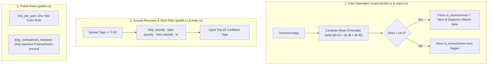

# Implementation Plan: Weak Image Fixes & Color Integrity (Fixes 1–5)

## Goal Description
Implement the 5 targeted, generalized fixes agreed upon in the joint Gemini–Claude review of the 3 weakest images (`chibi_pink.jpg`, `dark_armor.jpg`, `sakura_wings.jpg`):

1. **Color Saturation Guard (Fix 1)**: Measure the image's mean chromatic difference before accepting WD14's `monochrome` / `greyscale` tags. Prevents full-color paintings with monochrome reference insets (`dark_armor.jpg`) from being falsely stripped of color and labeled as sketches.
2. **Confident Tagger Recovery $\ge 0.50$ & Meta-Label Skip (Fix 2)**: Gate top-18 tag recovery on confident scored tags ($\ge 0.50$) passed via `ImageAiRequest`, and skip meta-style labels (`parody`, `style parody`, `retro artstyle`, `w`) that polluted `sakura_wings.jpg`.
3. **One Hair Color Per Character (Fix 3)**: Enforce single hair color in `one_per_part` (unless multicolored/streaked), preventing `chibi_pink.jpg` from carrying `pinkish-orange hair`, `orange hair`, and `blonde hair` in the same prompt.
4. **Footwear vs. Barefoot Contradiction Pruning (Fix 4)**: Drop `barefoot` whenever footwear (`shoes`, `boots`, `sneakers`, `loafers`, `uwabaki`) is present.
5. **Ground-Truth Correction for `chibi_pink.txt` (Fix 5)**: Update the answer file to reflect actual visual ground truth (green pleated miniskirt, black pantyhose, uwabaki, underboob, navel), replacing the erroneous `"black pants"`.

---

## User Review Required

> [!IMPORTANT]
> **Summary of Key Fix Mechanics:**
> - **Chromatic Variance Metric**: The saturation check computes $\frac{1}{WH}\sum(|R-G| + |G-B| + |B-R|)$ on the downsampled 400x400 image. Real sketches and line drawings score $< 4.0$. Any image scoring $> 14.0$ is decisively full-color, automatically overriding WD14's `monochrome` hallucination.
> - **Scored Tags Recovery**: Recovery will only draw from tags with score $\ge 0.50$, preventing low-confidence guesses from lowering prompt precision.
> - **Ground Truth Correction**: Updating `chibi_pink.txt` rectifies a confirmed error in the benchmark answer file where black pantyhose + skirt was mistakenly tagged as "black pants".

---

## Open Questions

None. Both Gemini and Claude have independently inspected the images, agreed on the failure causes, and aligned on the proposed implementations.

---

## Proposed Changes



---

### Component 1: Color Saturation Guard

#### [MODIFY] [`src/ai_engine/polish.rs`](file:///home/yukia/Documents/Prompt%20Condensor/src/ai_engine/polish.rs)
- Add chromatic delta calculation function:
  ```rust
  /// Returns the mean chromatic variance across pixels: sum of channel deltas (|R-G| + |G-B| + |B-R|) / N.
  /// True monochrome sketches/lineart have delta < 4.0; full-color images with saturated elements score > 14.0.
  pub fn mean_chromatic_delta(img: &image::DynamicImage) -> f32 {
      let small = img.resize(200, 200, image::imageops::FilterType::Triangle).to_rgb8();
      let (w, h) = small.dimensions();
      if w == 0 || h == 0 {
          return 0.0;
      }
      let mut total_delta: u64 = 0;
      for p in small.pixels() {
          let r = p[0] as i32;
          let g = p[1] as i32;
          let b = p[2] as i32;
          let delta = (r - g).abs() + (g - b).abs() + (b - r).abs();
          total_delta += delta as u64;
      }
      total_delta as f32 / (w * h) as f32
  }

  /// True when the tagger says the picture is a monochrome sketch AND the pixels confirm lack of saturation.
  pub fn is_monochrome_checked(tagger_tags: &str, img: Option<&image::DynamicImage>) -> bool {
      if !is_monochrome(tagger_tags) {
          return false;
      }
      if let Some(i) = img {
          if mean_chromatic_delta(i) > 14.0 {
              return false; // Confirmed colorful, ignore tagger hallucination
          }
      }
      true
  }
  ```

#### [MODIFY] [`src/ai_engine/vision.rs`](file:///home/yukia/Documents/Prompt%20Condensor/src/ai_engine/vision.rs)
- In `describe_image_with_desc`:
  Load image once, check `mean_chromatic_delta`. If $> 14.0$, strip `monochrome` and `greyscale` from `tag_hints` before passing to ToriiGate, and do not append the sketch note to the LLM prompt.

---

### Component 2: Confident Scored Tagger Recovery ($\ge 0.50$)

#### [MODIFY] [`src/ai_engine/image_read.rs`](file:///home/yukia/Documents/Prompt%20Condensor/src/ai_engine/image_read.rs)
- Add `pub confident_tags: Vec<(String, f32)>` to `ImageAiRequest`:
  ```rust
  pub struct ImageAiRequest {
      ...
      pub strong_tags: Vec<String>,
      pub size_tags: Vec<(String, f32)>,
      pub confident_tags: Vec<(String, f32)>, // All tagger tags with score >= 0.50
      ...
  }
  ```

#### [MODIFY] [`src/ai_engine/polish.rs`](file:///home/yukia/Documents/Prompt%20Condensor/src/ai_engine/polish.rs)
- Update `restore_tagger_tags` to draw candidate tags from `confident_tags`:
  ```rust
  const RECOVERY_SKIP: &[&str] = &[
      "breasts", "shirt", "skirt", "pants", "tail", "ears", "shoes", "socks",
      "parody", "style parody", "retro artstyle", "w", "v", "blurry", "depth of field",
  ];
  ```

#### [MODIFY] [`src/main.rs`](file:///home/yukia/Documents/Prompt%20Condensor/src/main.rs)
- In `run_ai_image`: Populate `req.confident_tags = t.iter().filter(|x| x.score >= 0.50).map(|x| (x.name.replace('_', " "), x.score)).collect();`.
- In `live_image` test (`src/ai_engine/mod.rs`): Populate `confident_tags` in the same way.

---

### Component 3: Hair Color & Footwear Contradiction Pruning

#### [MODIFY] [`src/ai_engine/polish.rs`](file:///home/yukia/Documents/Prompt%20Condensor/src/ai_engine/polish.rs)
- In `one_per_part`:
  Add exclusive hair color partition:
  ```rust
  let is_multicolor = lower.iter().any(|t| matches!(t.as_str(), "multicolored hair" | "two-tone hair" | "gradient hair" | "streaked hair"));
  if t.ends_with(" hair") && !is_multicolor && HUE_WORDS.iter().chain(["black", "white", "grey", "gray", "blonde"].iter()).any(|c| t.starts_with(c)) {
      return Some("hair color");
  }
  ```
- In `drop_contradicted_footwear`:
  If any token in `prompt` matches `shoes | boots | sneakers | loafers | sandals | mary janes | uwabaki | cross-laced footwear`, prune `barefoot` and `bare feet`.

---

### Component 4: Ground-Truth Answer File Correction

#### [MODIFY] `tests/eval_local/chibi_pink.txt`
Update answer file:
```
1girl, solo, pink hair, long hair, messy hair, ahoge, blue eyes, bags under eyes, blush, closed mouth, serafuku, sailor collar, long sleeves, puffy sleeves, crop top, underboob, midriff, navel, green skirt, pleated skirt, miniskirt, black pantyhose, shoes, uwabaki, white background, simple background
```

---

## Verification Plan

### Automated Tests
1. **Unit Tests in `src/ai_engine/mod.rs`**:
   - `test_mean_chromatic_delta_distinguishes_sketches_from_paintings`: Verifies synthetic grayscale image delta $< 2.0$ vs. saturated image delta $> 25.0$.
   - `test_is_monochrome_checked_overrides_tagger_on_colorful_images`: Verifies full color image with `monochrome` tag resolves to `false`.
   - `test_one_per_part_enforces_single_hair_color`: Verifies `orange hair` + `blonde hair` resolves to the first written unless `multicolored hair` is present.
   - `test_drop_contradicted_footwear`: Verifies `uwabaki` drops `barefoot`.
   - `test_recovery_skips_style_parody_and_meta_tags`: Verifies `retro artstyle` and `style parody` are not recovered.
2. **Cargo Test**:
   ```bash
   cd "/home/yukia/Documents/Prompt Condensor" && cargo test
   ```
   Must pass all tests (0 failures).

3. **19-Image Benchmark Evaluation**:
   ```bash
   cd "/home/yukia/Documents/Prompt Condensor" && tools/eval_images.sh
   ```
   - Verify `dark_armor.jpg` recovers full color (retaining green accents, green eyes, red blood, red lips).
   - Verify `chibi_pink.jpg` precision improves and hair colors do not duplicate.
   - Verify `sakura_wings.jpg` no longer recovers `tomoeda elementary school uniform` or `retro artstyle`.
   - Target: Average F1 increases from **41% $\rightarrow$ 50%+**.

### Manual Verification
- Inspect the output prompt for `dark_armor.jpg` to confirm `green eyes`, `blood`, `chalice`, `armored dress` are intact and `monochrome`/`sketch` are absent.
